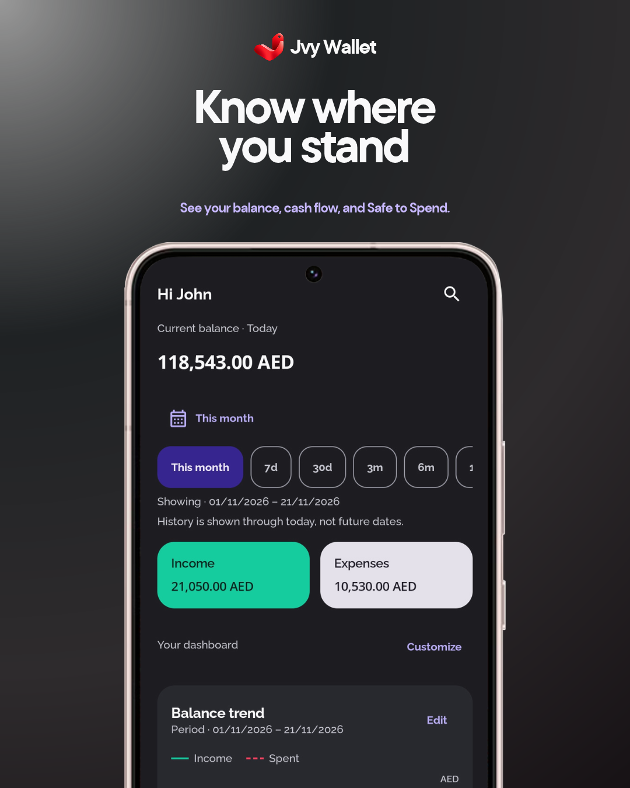
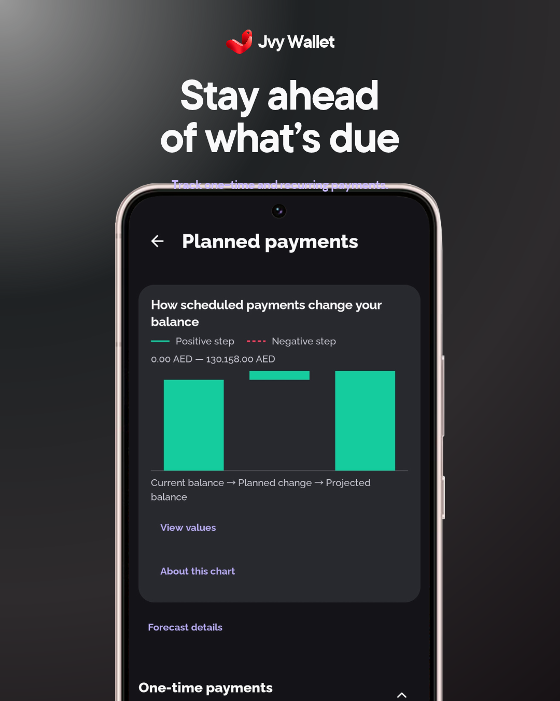
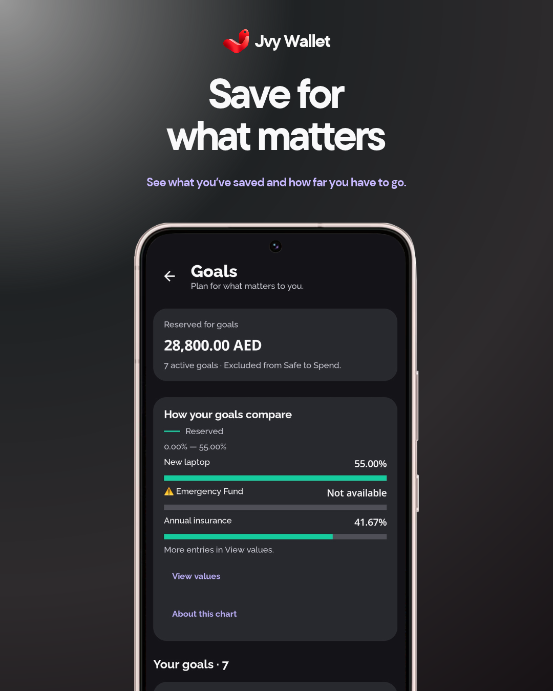
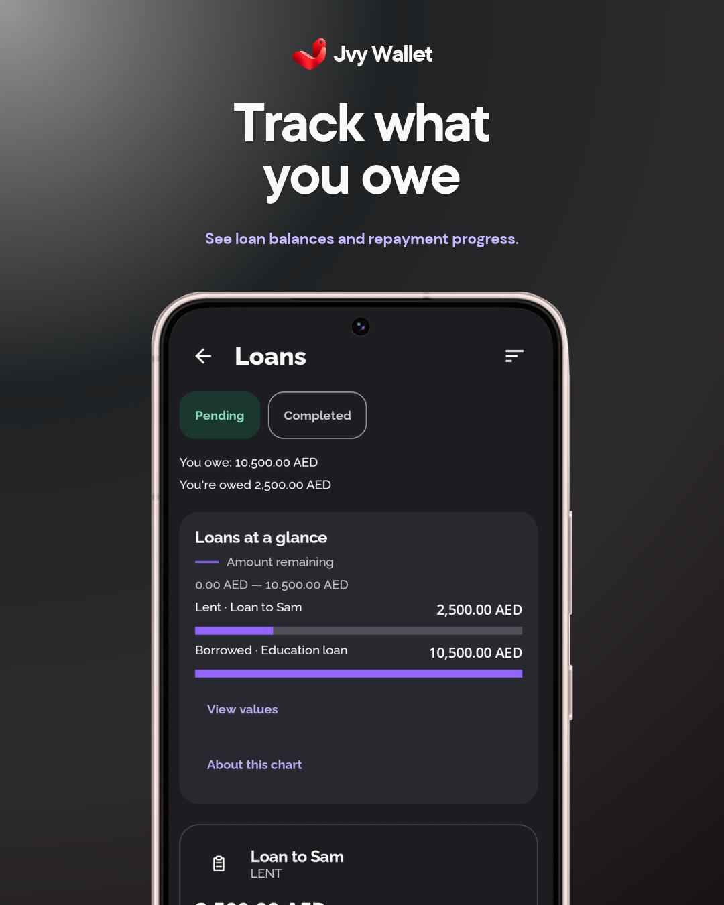
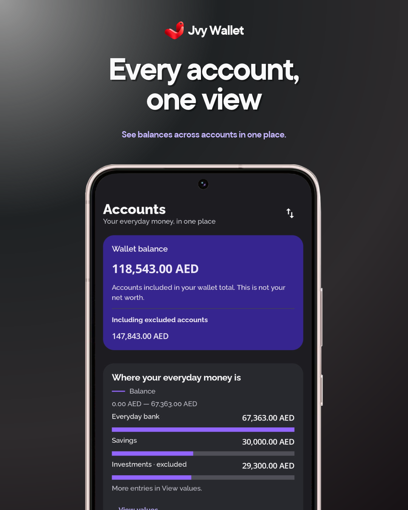
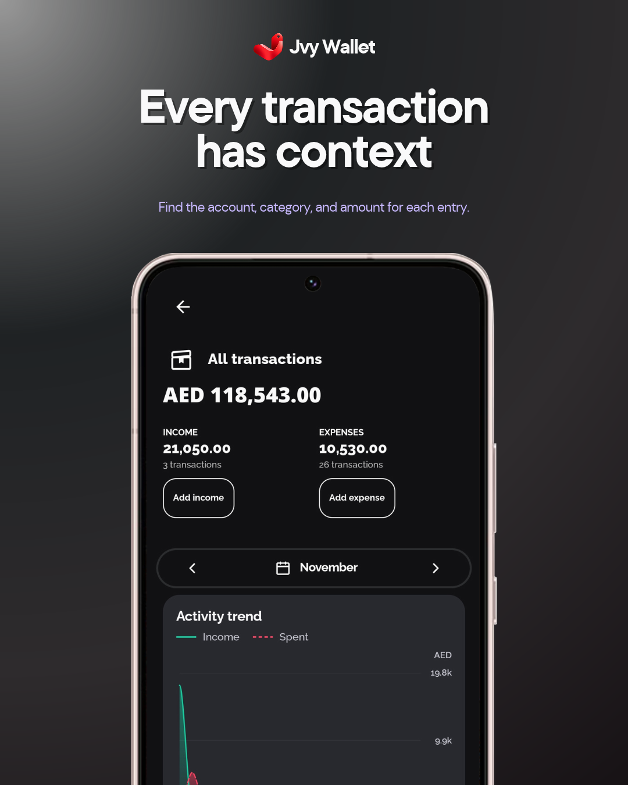
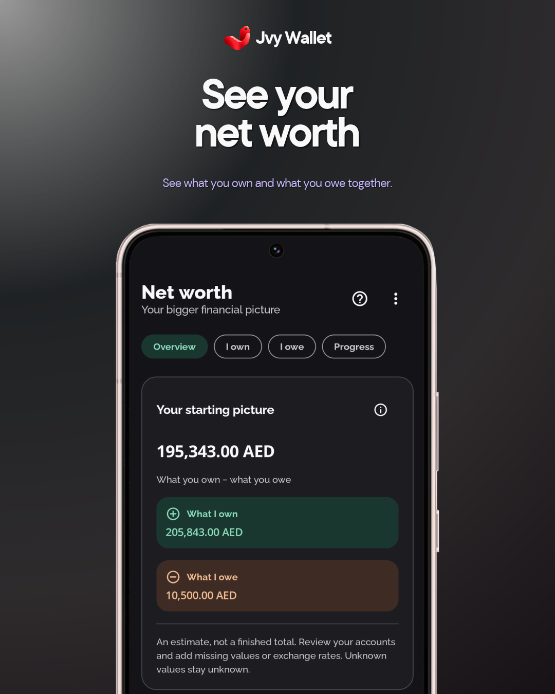
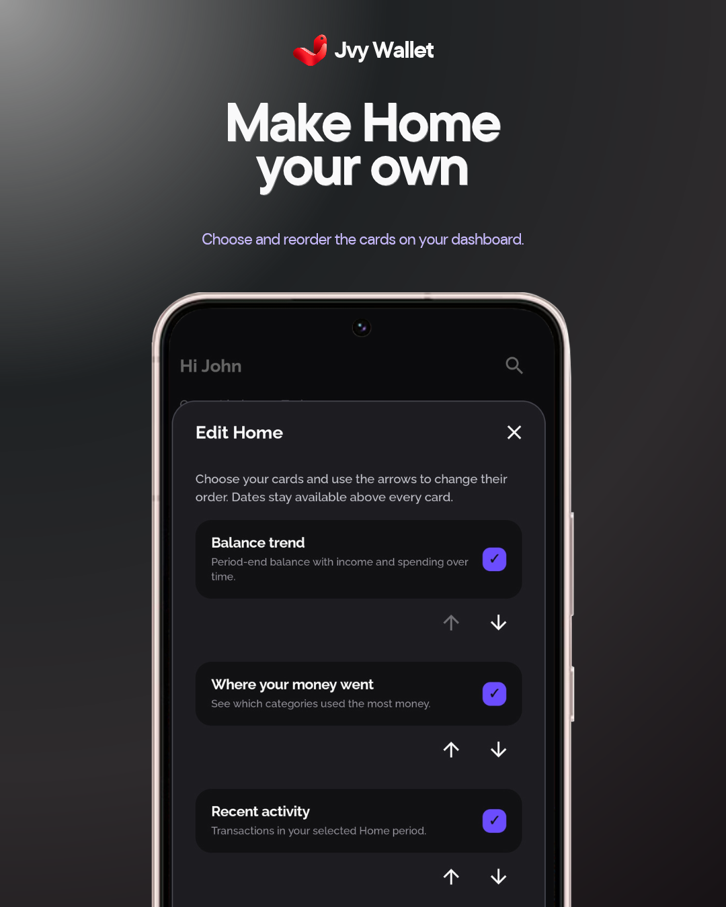
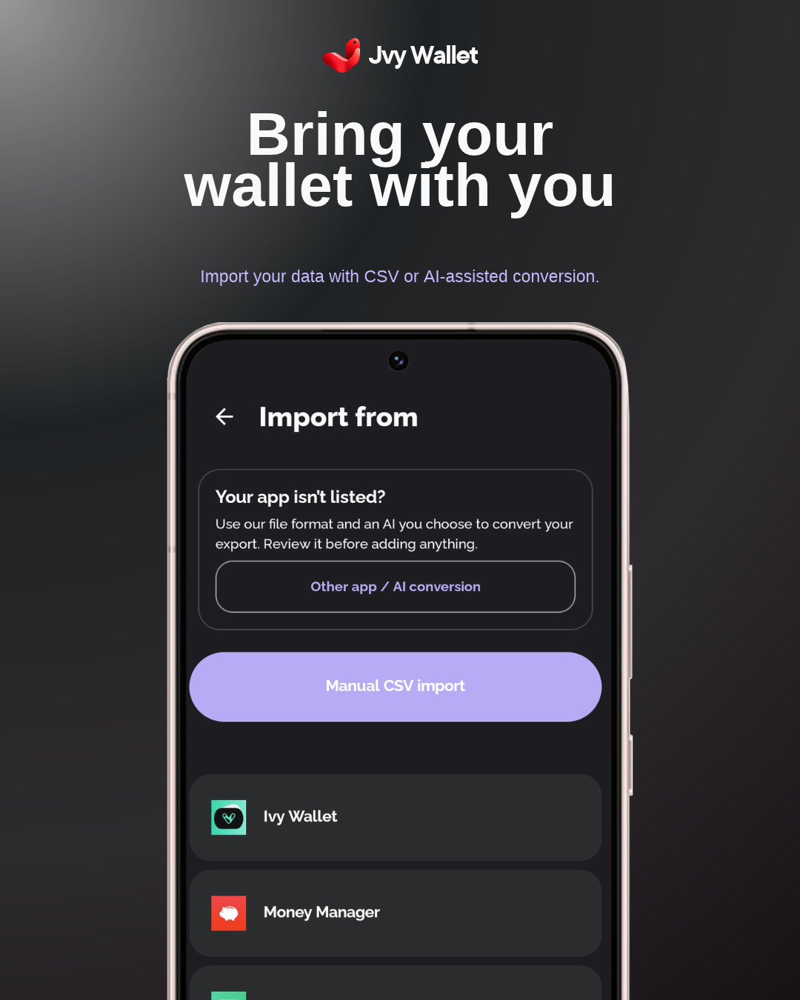

<div align="center">


# Jvy Wallet

### Know where you stand. Know what comes next.

**A private, local-first money manager for Android.** Track everyday spending, plan bills, protect savings, and understand your net worth — without linking a bank account or creating a cloud account.

[](https://github.com/joravarsinghing/ivy-wallet/releases/latest)
[](LICENSE)

**Android 9+** · **No ads** · **No required account** · **Manual-first** · **Open source**

[Get started](#getting-started) · [Features](#what-you-can-do) · [How to use](#how-to-use-jvy-wallet) · [Screenshots](#screenshots) · [Import & backup](#import-export-and-backup) · [Privacy](#privacy-and-security)



<sub>Latest published APK: v0.7.0 (8 November 2026), build 232 — prerelease; physical-device acceptance is still in progress.</sub>

</div>

---

## Your money, explained

Jvy Wallet helps you answer five questions:

- **How much do I have?** See balances across your cash and bank accounts.
- **What can I safely spend?** Set aside actual money for goals and see what remains available.
- **What is coming up?** See planned income and bills before they arrive.
- **Where did my money go?** Explore spending patterns, budgets, transactions and reports.
- **Am I building wealth?** Record assets, debts and dated valuations to review your net worth.

You enter or import your financial records; Jvy calculates from them. It does **not** connect to your bank, send money, trade investments or promise financial advice. Most everyday functions work offline; optional exchange-rate updates require internet access.

## Getting started

1. **Install the APK.** Open [the latest GitHub release](https://github.com/joravarsinghing/ivy-wallet/releases/latest), download `Jvy_wallet_v0.7.0.apk` (or the file named for a newer published version), and open it on Android 9 or newer. Android may ask you to allow installation from your browser or file manager.
2. **Choose your main currency.** Pick the currency in which you want your wallet-wide summaries. You can maintain accounts in other currencies too.
3. **Add your accounts.** Create a cash account, bank account, or any other account you want to track. Enter or adjust its opening balance using the provided balance controls; don't record an opening balance again as salary.
4. **Record a transaction.** Add an expense, income or transfer, selecting its account, category and date. Your ledger and summaries update from saved transactions.
5. **Make a plan.** Add a budget, a savings goal or a planned bill in **Plan**.
6. **Protect your data.** Configure app security in **More → Security** and create a full backup before upgrading or moving devices.

**Coming from another app?** Use the import flow instead of manually re-entering years of history. [See supported formats](#import-export-and-backup).

## What you can do

| Feature | What it helps you do |
| --- | --- |
| **Home and Safe to spend** | Understand your current money, reserved goals, upcoming commitments, cash flow, trends and recent activity. |
| **Customizable dashboard** | Reorder cards, hide cards you don't need and restore the default layout. |
| **Accounts** | Manage multiple accounts and currencies, inspect account activity, and distinguish balance from money reserved for goals. |
| **Transactions and transfers** | Track income, expenses and money moving between accounts with categories, descriptions and dates. |
| **Budgets** | Set spending limits for one or more categories and monitor usage and remaining allowances. |
| **Planned payments** | Prepare for one-time and recurring bills or income without prematurely changing your ledger. |
| **Goals** | Create savings targets, reserve real money across eligible accounts and see funding and deadline guidance. |
| **Loans** | Track money borrowed or lent, remaining principal and recorded repayments. |
| **Net worth** | Record what you own and owe, link existing accounts/loans where appropriate and review dated values and progress. |
| **Reports and Explore** | Filter your records and explore spending, cash-flow, wealth, debt and goals visually. |
| **Search, categories and tags** | Find and organize financial entries; remember categorization choices for future entries. |
| **Exchange rates** | View daily reference quotes, refresh them manually and retain manual overrides. |
| **Import, export and backup** | Bring in supported CSVs and Jvy/Ivy backups, export ledger CSV, and save native financial backups. |
| **Privacy and security** | Lock the app, mask money on screen and manage capture/security preferences. |

## Screenshots

These Jvy Wallet screenshots use fictional financial data.

<table>
<tr>
<td width="50%" valign="top"></td>
<td width="50%" valign="top"></td>
</tr>
<tr>
<td width="50%" valign="top"></td>
<td width="50%" valign="top"></td>
</tr>
<tr>
<td width="50%" valign="top"></td>
<td width="50%" valign="top"></td>
</tr>
<tr>
<td width="50%" valign="top"></td>
<td width="50%" valign="top"></td>
</tr>
<tr>
<td width="50%" valign="top"></td>
<td width="50%"></td>
</tr>
</table>


## How to use Jvy Wallet

### 1. Navigate the app

The five main sections are **Home · Accounts · Plan · Net worth · More**. On a phone they appear in the bottom navigation bar; on larger screens the app can use a navigation rail.

- **Home:** overview, Safe to spend, Money coming up, shared history dates, spending and activity. Use **Customize** to reorder or hide optional cards. Choose a rolling range, your current budgeting cycle or a custom window; income/spending, trends, breakdown and activity all follow the same selected historical dates. Current balance and future forecasts are intentionally not historical-period totals.
- **Accounts:** account balances, reserved/available money, account actions and activity. Account-level transfer activity can be displayed using its native sending/receiving currency values; internal transfers do not become new wallet-wide income.
- **Plan:** open **Budgets**, **Planned payments**, **Goals** and **Loans**.
- **Net worth:** manage assets, liabilities, historical valuations and progress.
- **More:** find **Reports**, **Search**, **Categories**, **Security**, **Settings** and other utilities.

### 2. Record income, expenses and transfers

1. Open the transaction-add action or choose an account and its **Add income / Add expense** action.
2. Select **Income**, **Expense** or **Transfer**, as appropriate.
3. Enter the amount and date, the account(s), and a meaningful title/category. Add notes or tags where useful.
4. Save and check the resulting entry in your history.

**Example:** Record `AED 48.00` for `Groceries` from your cash account. For a transfer from Cash to Bank, use **Transfer**, not an expense plus a second income. In different-currency transfers, review the actual sent and received amounts rather than assuming a bank exchange rate.

To find an entry later, open **More → Search**, a category's activity, or the full transactions view. Search and Reports use the records and filters you select. When you correct and save a transaction category, Jvy can remember an offline title-based category rule for future entries; it does **not** silently change older transactions.

### 3. Manage accounts and balances

Open **Accounts** to add or edit accounts, inspect their activity, and review their native currencies. Use the account's balance-adjustment action when correcting an opening or reconciled amount; do not count a balance correction as earned income. The account view also shows money **reserved for goals** separately from its remaining available balance. An account total is not your full net worth: see **Net worth** for assets and liabilities beyond the everyday ledger.

### 4. Budget everyday spending

Open **Plan → Budgets**, choose **Add**, set a limit and select the categories it covers. Watch the budget's progress and remaining amount as real categorized expenses are recorded. Multiple budgets may overlap: treat each as its own limit rather than adding their displayed totals together. If a budget goes over its limit, the app reflects that instead of hiding the overspend.

**Example:** `Dining out · AED 500` for your budgeting period. When you record AED 125 of dining expenses, you can see how much of that limit has been used.

### 5. Save toward goals and protect money

Open **Plan → Goals** and create a goal with a name, type, target and optional deadline. Open the goal and **reserve money** from one or more eligible accounts, then review its progress and the funding amount needed before the deadline.

**Example:** A laptop costs AED 6,000. You reserve AED 1,500 from Bank and AED 500 from Cash. Jvy shows AED 2,000 reserved toward the target, with AED 4,000 remaining. Only the **AED 2,000 actually reserved** affects available money; it does not pretend the remaining AED 4,000 already exists.

A reservation is an **internal earmark**, not a bank transfer or a new financial transaction. Check account currency eligibility and available funds before reserving. Emergency-fund coverage is based on actual reserved funds and the disclosed expense baseline — not merely on an ambitious target amount.

### 6. Plan bills and expected income

Open **Plan → Planned payments** to add a future expense or income and configure a one-time or recurring schedule. Review **Money coming up** on Home or the planned-payments forecast to see how upcoming events may change the money available.

**Example:** Set `Rent · AED 2,800 · monthly`. The payment remains a **projection** until you record/post the actual transaction. A forecast is not your bank balance or a guarantee: it uses the planned records you've entered and does not know about spending you haven't logged.

### 7. Track borrowing and lending

Open **Plan → Loans** to record money you **borrowed** or **lent**, check remaining principal and add repayments. Review the loan detail and its principal history; principal and interest are shown distinctly when supported by recorded data. When loans use different currencies, review them separately rather than interpreting a sum of unrelated units as a single amount.

### 8. Track net worth, assets and debts

Open **Net worth** to review the value of what you own minus what you owe. Add assets or liabilities and, where appropriate, **link an account or loan** rather than entering the same value twice. Record dated valuations to build a meaningful history and review progress over time.

**Example:** Track a vehicle, investment holdings and an outstanding loan alongside cash accounts. Values you never recorded are not invented; incomplete historical periods may appear as gaps. This is a record-keeping and valuation tool, not live portfolio trading or investment advice.

### 9. Explore reports and charts

Open **More → Reports**, apply the transaction filters and date range you want, then use **Explore** for additional visual analysis. The five groups are **Spending**, **Cash flow**, **Wealth**, **Debt** and **Goals**. Standard views cover category rankings, cash-flow comparisons, net-worth composition, loan principal and goal reservations; **Advanced** reveals additional charts when sufficient data exists.

Spending and cash-flow views use your **applied transaction filters**. Wealth, Debt and Goals summarize their **current workspaces**, independently of those transaction filters. Charts provide exact values alongside visuals and don't draw made-up history where observations are missing. More contextual charts also appear in accounts, budgets, transactions, planned payments, loans and net-worth views.

### 10. Use multiple currencies

Set a main currency in **Settings** and give each account its correct currency. Visit **Exchange rates** to see the quote provider, provider date and time of last successful update. Tap **Refresh** when you want newer reference quotes; stale/offline conditions are labelled. Manual rate overrides are preserved when automatic quotes refresh.

Jvy uses **daily reference rates**, not the exact rate a bank or card will execute. Don't infer an historical conversion from today's rate, and check unknown/unavailable conversions before trusting cross-currency reports.

## Import, export and backup

### Import from another money app

Open **More → Settings → Import data** (or choose import during onboarding). Select your source and file, review the mapped data and result, and only then import into a wallet you have backed up.

The repository includes CSV adapters for **Wallet by BudgetBakers, Money Manager, Spendee, Monefy, 1Money, Bluecoins, Money Manager by KTW, Fortune City and Financisto**, plus Ivy Wallet CSV compatibility and manual CSV mapping. The accepted shape depends on the app's export version; certain formats, such as Money Manager XLSX exports, must be converted to CSV first. **An adapter is not a guarantee that every source-app version and locale has been tested.** See [format-specific compatibility and limitations](docs/import-compatibility/README.md).

For an unlisted app, **Other app / AI conversion** offers a copyable schema and instructions. You choose whether to use a third-party AI outside Jvy. Bring the resulting JSON back to Jvy for **local validation, review and explicit confirmation**. Jvy itself does not upload your wallet or export to an AI service. Check account balances, omitted fields, currencies and paired transfers yourself; a schema-valid file can still misunderstand the source. [Conversion guide](docs/import-compatibility/AI-CONVERSION.md).

### Export or back up your data

In **Settings**, use the available export/backup actions to save a **CSV ledger** or a **complete native Jvy/Ivy backup**. Native JSON/ZIP is the appropriate format for restoring the app's richer data; **CSV is not a complete backup**. Keep the original export until you've checked the import counts, accounts, transactions, transfers, goals, loans and net-worth values.

**Important:** Native backup files are **not automatically encrypted**. Protect them in private or encrypted storage. Backups of financial data intentionally do **not** transfer your app PIN/recovery credentials.

### Update without risking your records

Before an APK update, create and verify a complete native backup. The v0.7.0 signed APK uses package `com.ivy.wallet`; an owner-signed installation with the **same certificate** may be eligible for an in-place update, but physical in-place acceptance remains pending. A `com.ivy.wallet.debug` build is a **separate app**. An original Ivy Wallet installation with a different signature cannot be replaced directly by Jvy, even if the package ID matches.

**Never uninstall the existing app or clear storage just to work around a signing conflict.** First preserve a complete backup and validate its restore in a separate installation/device/profile. After updating or restoring, reconcile balances and key records before relying on them. [Latest release and update notes](https://github.com/joravarsinghing/ivy-wallet/releases/latest).

## Privacy and security

- **Your ledger stays local:** core use needs no bank login, Jvy cloud account or advertising profile.
- **App lock:** PIN and biometric/device-supported authentication options, with recovery controls. Set these up in **More → Security**.
- **Hide balances:** conceal sensitive values and financial chart details on screen; this is a display safeguard, **not data encryption**.
- **Capture preferences:** control the app's screenshot/capture behavior through security settings; sensitive authentication surfaces remain protected.
- **Offline core:** recording and reviewing your money works without a bank connection. Optional rate refreshes and external links use the network.
- **Manual backups:** exported files are your responsibility to secure; Jvy does not provide automatic encrypted cloud backups.
- **No automatic crash reporting** in this prerelease.

Read the [Privacy Policy](docs/legal/PRIVACY_POLICY.md) and the bundled Terms within the app. Jvy Wallet does not move money between banks or provide financial recommendations.

## Frequently asked questions

<details><summary><strong>Does Jvy Wallet connect to my bank?</strong></summary>

No. You record or import transactions yourself. There is no automatic bank synchronization.

</details>
<details><summary><strong>Is Safe to spend the same as my balance?</strong></summary>

No. Your balance records the money in eligible accounts; Safe to spend factors in money reserved for goals and applicable planning context. Its forecast and your historical spending totals answer different questions.

</details>
<details><summary><strong>Will creating a goal or scheduled payment change my bank balance?</strong></summary>

No. Goal reservations earmark existing money internally; scheduled payments are forecasts until posted as transactions.

</details>
<details><summary><strong>Can I transfer my old Ivy Wallet data?</strong></summary>

Supported Ivy Wallet native JSON/ZIP backup restore and CSV import paths are available. Preserve your original backup and verify the restored records; compatibility can vary with older data and signing/install paths.

</details>
<details><summary><strong>Can I use it without internet?</strong></summary>

Yes, for the everyday ledger and planning tools. Exchange-rate lookups and external web links require connectivity.

</details>
<details><summary><strong>Is v0.7.0 a stable, fully device-tested release?</strong></summary>

No. It is a published prerelease. Focused tests, compilation and APK checks passed, but on-device upgrade, accessibility, performance and cohort acceptance are not complete. Keep backups and report reproducible problems.

</details>

## For developers and contributors

Jvy Wallet is a Kotlin/Jetpack Compose Android project and an independent continuation of [Ivy Wallet](https://github.com/Ivy-Apps/ivy-wallet). To work locally, clone the repository, open it in Android Studio with its configured JDK, then run the Gradle tasks appropriate to your change.

```bash
# macOS / Linux
./gradlew test

# Windows PowerShell
.\gradlew.bat test
```

See [Contributing](CONTRIBUTING.md), [developer guidelines](docs/guidelines/README.md), [design language](docs/design/JVY-DESIGN-LANGUAGE.md), [APK generation rules](docs/standards/APK-GENERATION.md) and [release checklist](docs/releases/PUBLIC-RELEASE-CHECKLIST.md). Releases require the appropriate private signing setup; don't publish a debug build as a production APK. The public release's v0.7.0 source corresponds to commit `7768a762436d6ab3f4597063142325a310fd5edc` plus subsequent documentation/metadata preparation.

Bug reports and pull requests are welcome at [GitHub Issues](https://github.com/joravarsinghing/ivy-wallet/issues). Include app version, Android version and steps to reproduce — **never attach real financial records, backup files, PINs or recovery codes**.

## Credits and license

Maintained by **Joravar Singh**, building on the original open-source [Ivy Wallet](https://github.com/Ivy-Apps/ivy-wallet) and its contributors. Licensed under the [GNU General Public License v3.0](LICENSE). See the bundled Terms for the relevant source and asset notices.

[GitHub](https://github.com/joravarsinghing) · [LinkedIn](https://www.linkedin.com/in/joravarsingh/) · [Portfolio](https://joravarsinghing.github.io/portfolio/)

<div align="center"><strong>If Jvy Wallet helps you manage money with more clarity, consider starring the repository. ⭐</strong></div>
