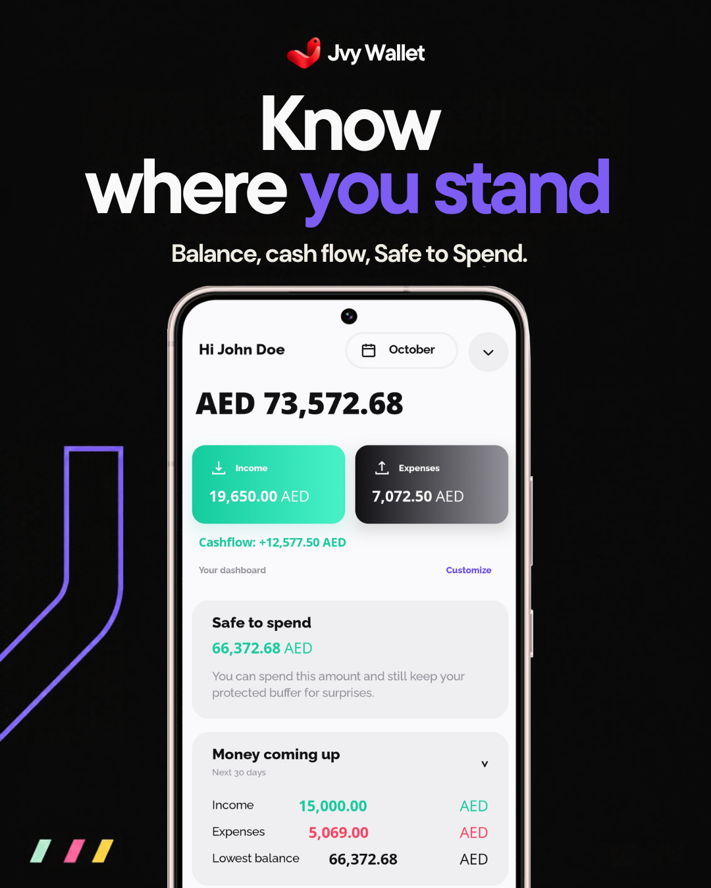
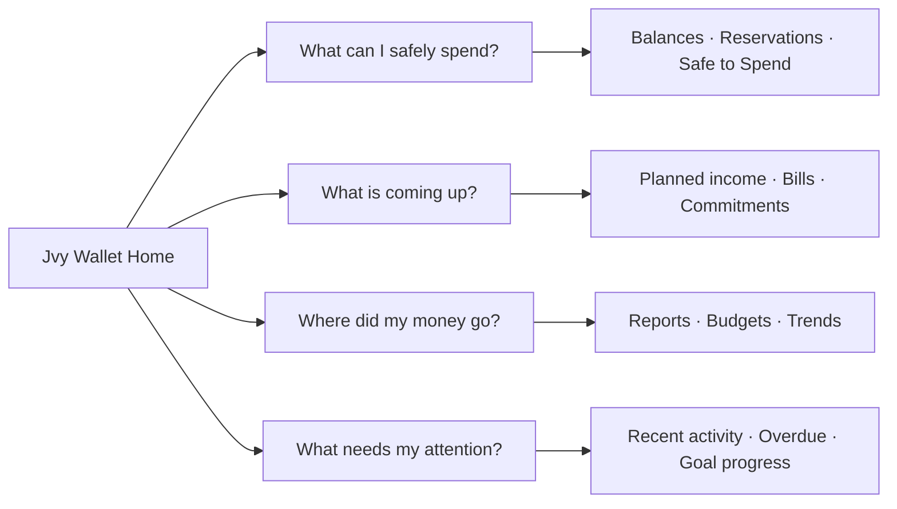
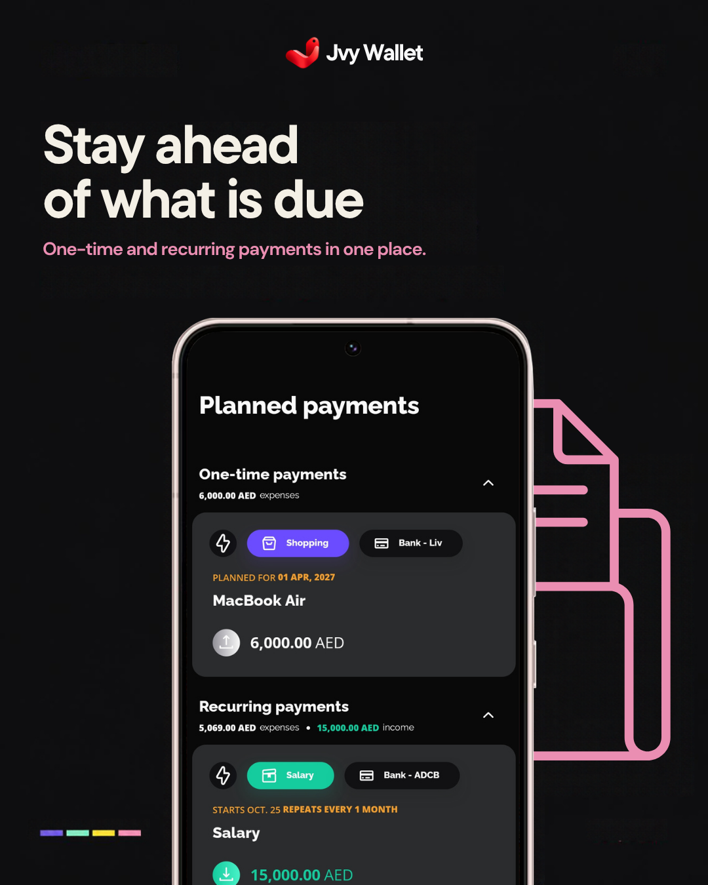
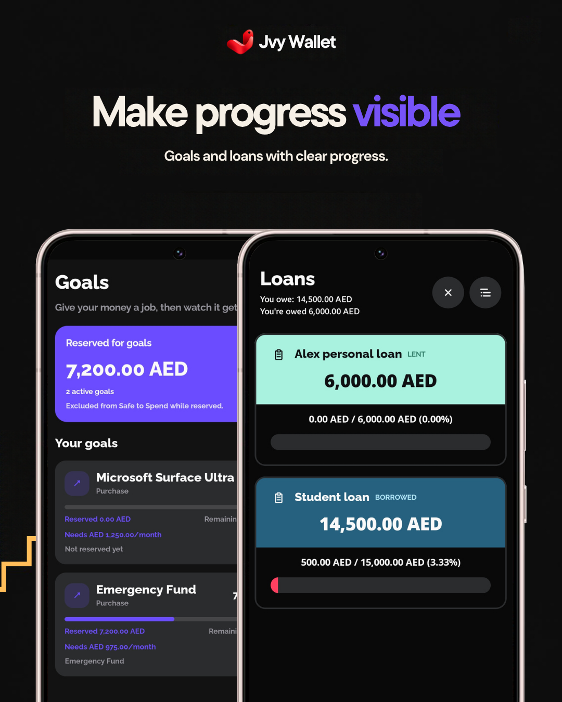
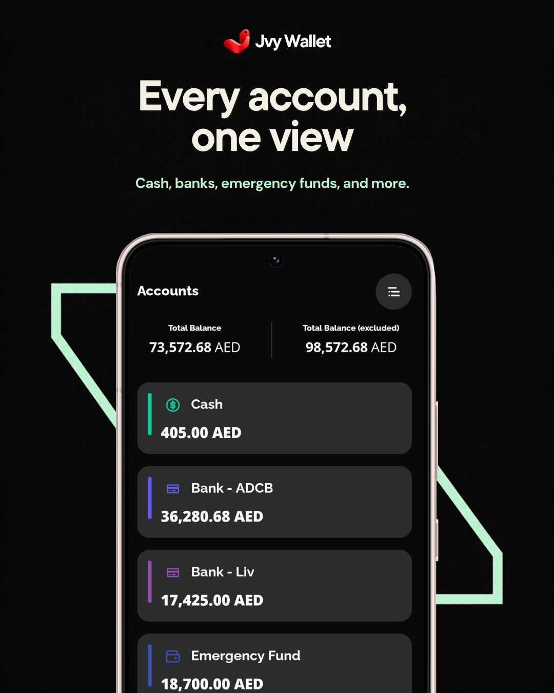
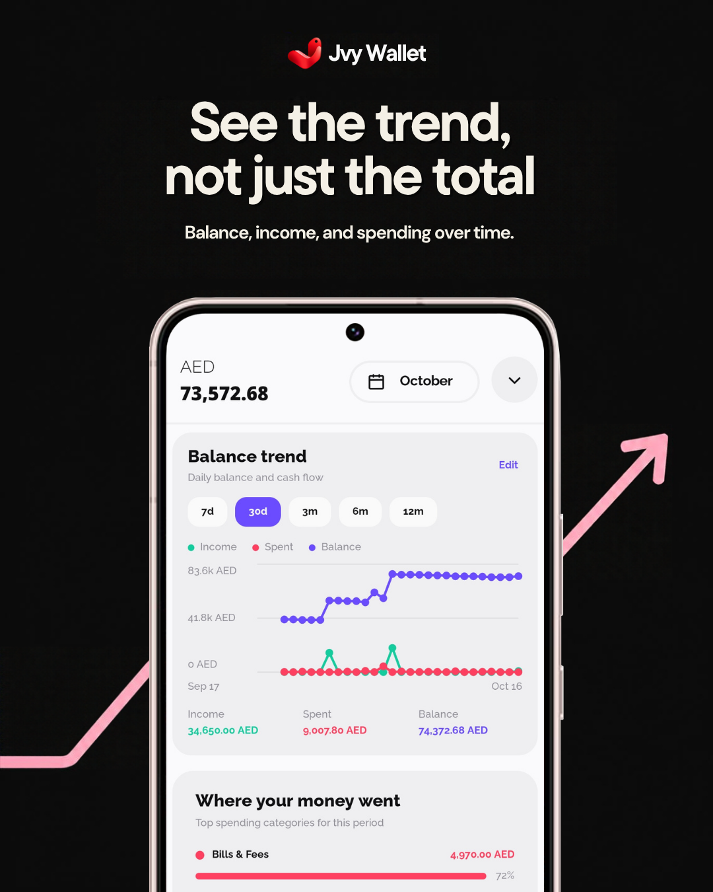
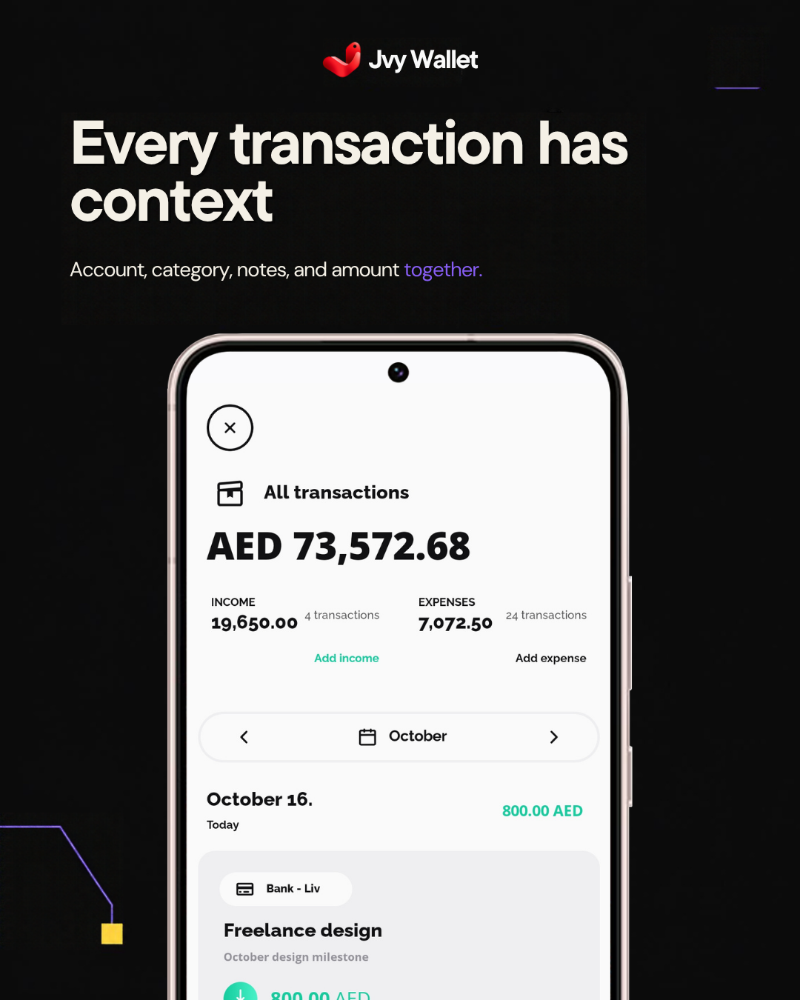
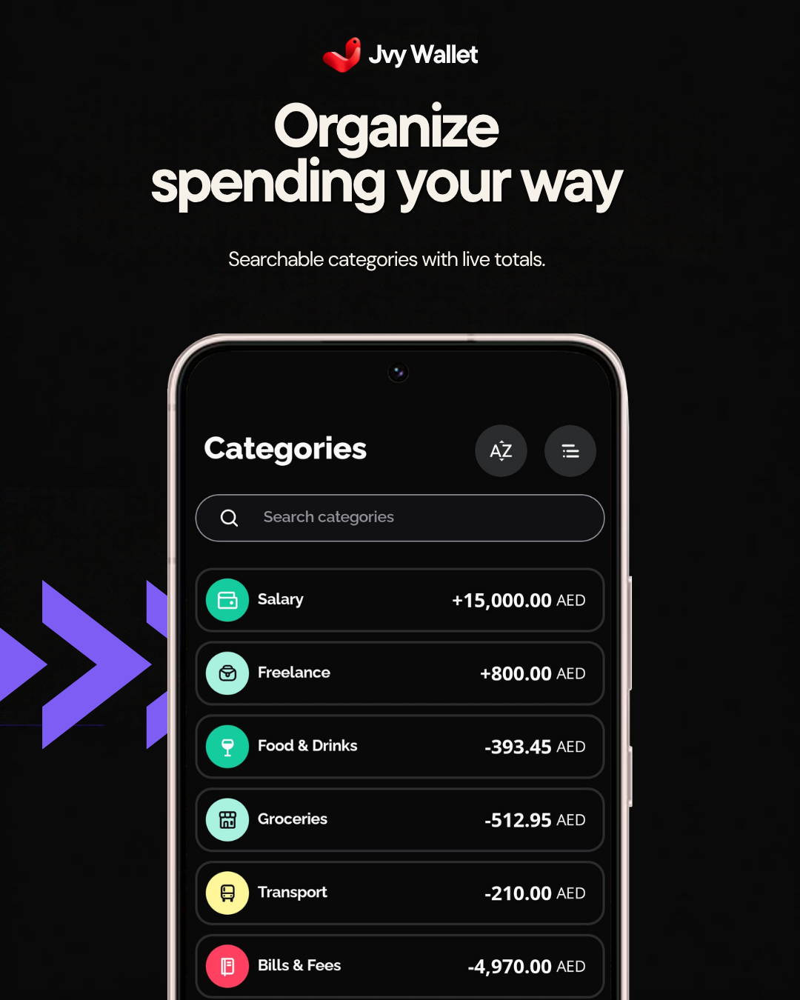
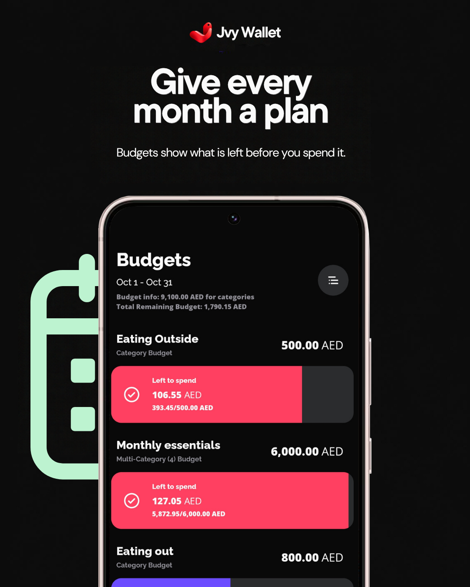

<div align="center">


# Jvy Wallet

### Know where you stand.

**The calm, local-first Android money manager that tells you what you can *safely* spend.**
No bank sync. No ads. No cloud account. Just an honest ledger you control.

<br/>

[](https://github.com/joravarsinghing/ivy-wallet/releases/latest)
[](https://github.com/joravarsinghing/ivy-wallet/stargazers)
[](LICENSE)


[](https://github.com/joravarsinghing/ivy-wallet/actions)
[](https://github.com/joravarsinghing/ivy-wallet/commits)
[](CONTRIBUTING.md)

[**Download**](#-install) · [**Features**](#-features) · [**Screenshots**](#-screenshots) · [**Privacy**](#-privacy--security) · [**Roadmap**](#-roadmap) · [**Contribute**](#-contributing)

<br/>



</div>

---

## 💡 Why Jvy Wallet?

Every budget comes down to one question:

> **What do I have, what's coming, and what can I safely do next?**

Most finance apps answer with a wall of charts, a bank-sync login, or a subscription. Jvy Wallet answers in **one scan**: your balance, your upcoming commitments, and the amount that's genuinely **safe to spend** after goals and protected money are set aside.

It's **manual-first and fully explainable**. Every number traces back to a record you entered. It doesn't pretend to be a bank connection, an investment platform, or a financial adviser.

| | Typical finance app | **Jvy Wallet** |
|---|---|---|
| Bank login required | Usually | **Never** |
| Where your data lives | Their servers | **Your device** |
| Ads / data profile | Often | **None** |
| "Safe to Spend" after goals | Rare | **Built in** |
| Numbers you can explain | Black box | **Ledger is the source of truth** |
| Switching in / out | Painful | **Guided CSV import + full backup** |

---

## ✨ Features

<table>
<tr>
<td width="50%" valign="top">

### 🧭 Know your position
Balances across cash, banks, emergency funds and more, with **Safe to Spend** that accounts for goal reservations and protected money.

</td>
<td width="50%" valign="top">

### 📅 Plan ahead
One-time and recurring **planned payments** stay visible as projections until you post them. No surprises, no fake transactions.

</td>
</tr>
<tr>
<td valign="top">

### 🎯 Give money a job
**Goals** for purchases, travel, emergency funds, or anything personal. Reserved money is metadata, so your ledger stays clean.

</td>
<td valign="top">

### 📈 Understand the pattern
Daily and monthly **balance trends**, **reports**, **budgets**, and ranked category breakdowns, with honest handling of sparse history.

</td>
</tr>
<tr>
<td valign="top">

### 🧾 Context on every entry
Account, category, title, notes and amount recorded together, so your history is still useful a year later.

</td>
<td valign="top">

### 🔄 Portable by design
Full backups, CSV ledger export, and guided import from the apps you may already use.

</td>
</tr>
</table>

### Built around four decisions



---

## 🔄 Bring your history with you

Jvy Wallet keeps the import path local and explicit. Choose the source format, select its exported CSV, review the result, and import only what you recognize. Full Jvy/Ivy backup JSON and ZIP restores are also supported, including UTF-8 and UTF-16 files.

<table>
  <tr>
    <td align="center"><br/><sub>Ivy Wallet</sub></td>
    <td align="center"><br/><sub>Money Manager</sub></td>
    <td align="center"><br/><sub>Wallet</sub></td>
    <td align="center"><br/><sub>Spendee</sub></td>
    <td align="center"><br/><sub>Monefy</sub></td>
  </tr>
  <tr>
    <td align="center"><br/><sub>1Money</sub></td>
    <td align="center"><br/><sub>Bluecoins</sub></td>
    <td align="center"><br/><sub>KTW Money Manager</sub></td>
    <td align="center"><br/><sub>Fortune City</sub></td>
    <td align="center"><br/><sub>Financisto</sub></td>
  </tr>
</table>

Manual CSV import remains available for files from other apps. Source-app logos in this section identify import formats only; they are not Jvy branding. See the [import compatibility notes](docs/import-compatibility/README.md) for the evidence and current verification status of each format.

---

## 📸 Screenshots

> *All screenshots use an illustrative "John Doe" dataset. No real finances are shown.*

<table>
  <tr>
    <td width="50%" valign="top">
      
      <h4>Know where you stand</h4>
      <p>Balance, cash flow, Safe to Spend and the next 30 days in one scan.</p>
    </td>
    <td width="50%" valign="top">
      
      <h4>Stay ahead of what's due</h4>
      <p>One-time and recurring commitments, visible before they bite.</p>
    </td>
  </tr>
  <tr>
    <td valign="top">
      
      <h4>Make progress visible</h4>
      <p>Reserved money, deadlines, funding guidance and loans, with no hidden math.</p>
    </td>
    <td valign="top">
      
      <h4>Every account, one view</h4>
      <p>Cash, banks and emergency funds with account-level context.</p>
    </td>
  </tr>
  <tr>
    <td valign="top">
      
      <h4>See the trend, not just the total</h4>
      <p>Daily and monthly views showing peaks, quiet periods and carried-forward balance.</p>
    </td>
    <td valign="top">
      
      <h4>Every transaction has context</h4>
      <p>Account, category, notes and amount, together.</p>
    </td>
  </tr>
  <tr>
    <td valign="top">
      
      <h4>Organize spending your way</h4>
      <p>Searchable categories with live totals.</p>
    </td>
    <td valign="top">
      
      <h4>Give every month a plan</h4>
      <p>See what remains before you spend it, including multi-category budgets.</p>
    </td>
  </tr>
</table>

---

## 📲 Install

**Option 1: Download the APK (recommended)**

1. Open the [**latest release**](https://github.com/joravarsinghing/ivy-wallet/releases/latest).
2. Download `Jvy_wallet_vX.Y.Z.apk`.
3. Verify it against the checksum manifest published alongside it.
4. Allow installs from your browser or file manager when Android asks, then open the APK.

**Option 2: Build from source**: see [Build from source](#-build-from-source).

---

## 🔒 Privacy & security

Jvy Wallet is for people who want useful money tools **without handing their financial history to an aggregator**.

| | |
|---|---|
| 🔐 **Biometric app lock** | Android device credential or biometric (including fingerprint where supported). Relocks after inactivity. |
| 🙈 **Privacy mode** | Hide balances and income on the dashboard; reveal them temporarily when you choose. |
| 🏠 **Local-first** | No bank sync, no advertising profile, and no cloud account required for the core ledger. |
| 💾 **Portable backups** | Export a full backup or a CSV ledger from Settings, and restore on another installation. |
| 🔁 **Easy migration** | Guided CSV import from Wallet by BudgetBakers, Monefy, Spendee, Money Manager, 1Money, Bluecoins, KTW Money Manager, Fortune City, Financisto, and more. |

> [!IMPORTANT]
> Backups are **user-controlled files, not encrypted cloud storage**. Keep exports somewhere private, and use Android device security, a trusted password manager, or encrypted storage when sharing or archiving them.

Read the complete [Jvy Wallet Privacy Policy](docs/legal/PRIVACY_POLICY.md) for details about local storage, imports, backups, diagnostics, permissions, and deletion.

<details>
<summary><b>What Jvy Wallet deliberately does <u>not</u> do</b></summary>

<br/>

- ❌ Automatic bank synchronization
- ❌ Investment advice or an investment platform
- ❌ Cloud backup
- ❌ Silently rewriting historical transactions or moving money between accounts

Bank sync and cloud backup would each require a separate security and privacy review before being offered or marketed.

</details>

---

## 🧠 Product principles

<details open>
<summary><b>Explainable money</b></summary>

The ledger is the source of truth. Goals reserve money as metadata and never create fake transactions. Planned payments stay projections until you post them. Balance, Safe to Spend and reports can always be explained from the records you entered.
</details>

<details>
<summary><b>Useful density</b></summary>

Readable rows, compact summaries, clear hierarchy, and focused cards instead of oversized dashboards that repeat the same number. The Accounts tab owns detailed account management; Home shows only derived insights that answer a different question.
</details>

<details>
<summary><b>Honest history</b></summary>

Charts distinguish *missing* history from *real zero-activity* periods. Daily and monthly views use calendar identities, preserve gaps before the first observed activity, and never invent a trend from data that doesn't exist.
</details>

<details>
<summary><b>Safe evolution</b></summary>

Compatibility with supported Ivy Wallet backup data is preserved where possible. New features must not silently rewrite historical transactions, alter import meaning, or move money between accounts.
</details>

---

## 🗺️ Roadmap

**Now**

- Goal funding guidance, deadlines and multi-account reservations
- Balance and cash-flow trends with daily/monthly ranges and sparse-history handling
- Compact Home activity and ranked spending breakdowns
- Reports that update from any filter and render useful zero-result states
- Reliable imports, backup validation and recovery paths
- Consistent, normal-sized mobile UI across Home, Accounts, Reports, Settings and entry screens

**Next**

- More explainable historical balance and net-worth views
- Better goal funding plans and on-track guidance
- Optional recurring-transaction and remembered-category suggestions
- Monthly financial check-ins and emergency-fund planning
- Stronger backup versioning, validation and recovery tools

**Later**

- Debt payoff and investment views, *only after the core ledger stays dependable*

See [ROADMAP_STATUS.md](ROADMAP_STATUS.md) for live status.

---

## 🛠️ Build from source

**Requirements**

- Android Studio with the bundled JDK
- An Android device or emulator on a supported Android version
- Primary manual QA target: Samsung Galaxy S22 Ultra, Android 16 / One UI 8

**Run tests**

```bash
# macOS / Linux
./gradlew test

# Windows
.\gradlew.bat test
```

Before changing imports, balances, money calculations, reservations or chart bucketing, run the relevant compatibility, domain, UI-snapshot and regression tests.

**Build a numbered release APK** (Windows, from the repo root)

```powershell
.\scripts\build-jvy-apk.ps1
```

This produces artifacts like `Jvy_wallet_v0.2.5.apk` in `artifacts/apk/`, records the Android `versionCode`, and writes a checksum manifest beside the APK. Don't distribute the raw Gradle output filename. Full rules: [APK generation standard](docs/standards/APK-GENERATION.md).

---

## 🤝 Contributing

Contributions are welcome, from bug reports to pull requests.

1. Read the [Contributing guide](CONTRIBUTING.md) and [Developer guidelines](docs/guidelines/README.md).
2. Read the [Mobile UI standards](docs/guidelines/Mobile-UI-Standards.md) before touching any screen. They cover gutters, safe areas, density, money formatting, trend semantics, logo variants, reports and hidden balances.
3. Open an issue or draft PR early, and include reproducible steps and screenshots.

> [!WARNING]
> Please **never** include real financial records in public issues or screenshots.

<details>
<summary><b>All documentation</b></summary>

- [Roadmap status](ROADMAP_STATUS.md)
- [Developer guidelines](docs/guidelines/README.md)
- [Mobile UI standards](docs/guidelines/Mobile-UI-Standards.md)
- [Goal and saving-pool plan](docs/plans/001-goals-and-saving-pools.md)
- [Dashboard research notes](docs/recon/BUDGETBAKERS-UI-REFERENCE-AND-JVY-MASHUP.md)
- [APK generation standard](docs/standards/APK-GENERATION.md)
- [Agent instructions](AGENTS.md)
- [Contributing guide](CONTRIBUTING.md)

</details>

---

## ❓ FAQ

<details>
<summary><b>Does Jvy Wallet connect to my bank?</b></summary>
No, and that's deliberate. You record your own transactions, which keeps the app private and every number explainable.
</details>

<details>
<summary><b>Where is my data stored?</b></summary>
On your device. No cloud account is required for the core ledger.
</details>

<details>
<summary><b>Can I bring my data from another app?</b></summary>
Yes. Guided CSV import supports Wallet by BudgetBakers, Monefy, Spendee, Money Manager, 1Money, Bluecoins, KTW Money Manager, Fortune City, Financisto and other supported formats, plus compatible Ivy Wallet backups.
</details>

<details>
<summary><b>How is this related to Ivy Wallet?</b></summary>
Jvy Wallet is an independent continuation of the open-source Ivy Wallet. It preserves compatibility with supported Ivy Wallet data where possible, while branding, product direction, releases and support are maintained independently.
</details>

<details>
<summary><b>Is it financial advice?</b></summary>
No. It's a ledger and planning tool, not an adviser or investment platform.
</details>

---

## 🙏 Credits & license

Jvy Wallet is an independent continuation of [Ivy Wallet](https://github.com/Ivy-Apps/ivy-wallet), maintained by **Joravar Singh**. Thanks to the original authors and contributors whose open-source work made this possible.

Distributed under the **[GNU General Public License v3.0](LICENSE)**.

## 📬 Contact & support

[](https://github.com/joravarsinghing)
[](https://www.linkedin.com/in/joravarsingh/)
[](https://joravarsinghing.github.io/portfolio/)

For support, [open an issue](https://github.com/joravarsinghing/ivy-wallet/issues) with reproducible steps and screenshots.

<div align="center">

<br/>

**If Jvy Wallet helps you see your money clearly, a ⭐ goes a long way.**

[](https://star-history.com/#joravarsinghing/ivy-wallet&Date)

</div>
